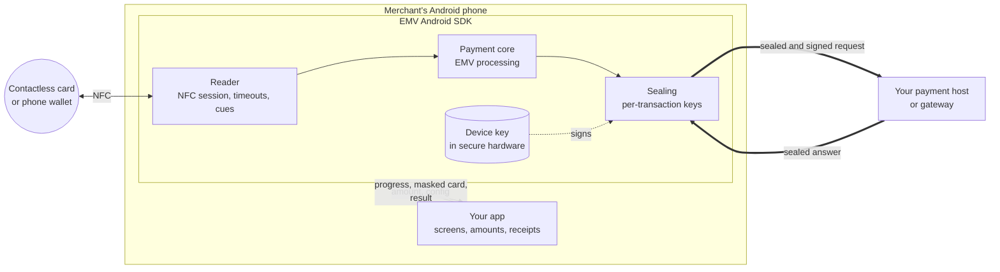
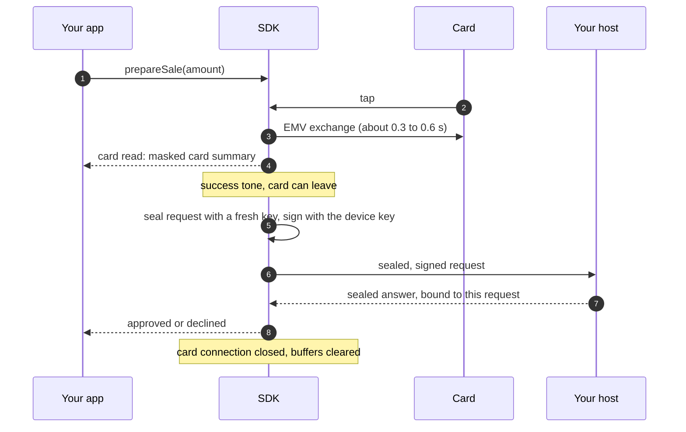

# Architecture and security

The SDK is built on one principle: **card data stays inside the SDK.** Your app runs the sale, shows the screens and talks to its own systems. It never handles a card number, a cryptogram or a PIN in clear, so none of them can leak through your code, your logs or your screenshots.

## The pieces

| Piece | What it does | What your app sees |
|---|---|---|
| **Reader** | Owns the phone's NFC reader. It runs one card at a time, enforces timeouts, ends a sale cleanly when the card leaves, and plays the tap sound and vibration. | Progress states and NFC diagnostics. Neither carries card data. |
| **Payment core** | Runs the EMV contactless transaction with the card, from selecting the application to the cryptogram. It runs in native code inside the SDK. | The stage it has reached, and the outcome. |
| **Sealing** | Encrypts the whole online request for your host, inside the SDK, as soon as the card read ends. | Only a masked card summary: scheme, application, first 6 and last 4 digits, amount and currency. |
| **Device key** | A signing key created in the phone's secure hardware (StrongBox or TEE). It never leaves the hardware, and it is enrolled with your host once, with hardware attestation. | Nothing. Only the terminal ID it was enrolled under. |

## A sale, step by step

## Security guarantees

**Card data**
- The SDK's public API has no field that holds a full card number, expiry, track data, cryptogram or the cleartext online request. Your app gets a masked summary only.
- The online request is encrypted inside the SDK with AES-256-GCM, under a key agreed for this transaction alone (ECDH P-256, then HKDF-SHA-256). Each request is bound to the terminal, a transaction number and a timestamp, and signed by the device key. A host can detect a replayed, altered or forwarded request.
- The answer is encrypted under a key that only this request's exchange knows. An answer that doesn't decrypt, or names another transaction, is never treated as an approval.
- The host's key must carry a certificate chain to a vendor root built into the SDK. The payment core verifies it and seals to no other key; configuration pins are an optional extra check. The SDK picks up a rotated host key by itself, without enrolling again.
- Card buffers and keys are overwritten as soon as each step has used them. When a sale ends, the payment core drops everything it read from the card.

**The device**
- The device key lives in secure hardware, StrongBox when the phone has it, and can't be exported.
- At enrolment, the phone proves where the key lives with hardware key attestation, checked against Google's attestation roots.
- A terminal is activated once with a single-use, expiring code bound to one merchant. Your processor sees the merchant and terminal IDs bound at activation, never IDs from the app's configuration.
- Payment screens can be protected from screenshots, the recent-apps view and overlays.

**Configuration**
- One strict JSON document configures the SDK. Comments, duplicate keys, unknown fields and trailing data are rejected, and the payment core checks the terminal profile before it's accepted. A bad configuration never replaces a good one.
- A new configuration never changes a sale that's already in progress.

**The build you ship**
- Release builds of the SDK contain no test host, no "approve everything" shortcut and no card-data debugging hooks. Those exist only in debug builds, and the release package is checked for their absence.
- Diagnostics and timing reports carry no card data, so they're safe to attach to a support ticket.
- Errors are fixed categories with safe messages. They never carry platform exception text or card data.

## Where it's going

| Area | Status |
|---|---|
| Sealed card data inside the SDK | Shipping |
| Hardware device key with attestation at enrolment | Shipping |
| Attestation checked at enrolment and on every payment (verified chain, hardware key, verified boot, app identity, revocation) | Shipping |
| Phone-wallet sales above the cardholder verification limit | Shipping |
| Host keys certified by a vendor root built into the SDK; single-use terminal activation codes; host key rotation without re-enrolment | Built; pending the vendor root ceremony and device verification |
| Durable recovery of a sale whose host answer is lost: one transaction id and STAN per sale, a record kept before the request leaves, status query then reversal, resumed after a restart | Built; pending device verification |
| PIN entry on the phone screen, test grade | Planned |
| PIN entry for production, under PCI MPoC | Planned; needs certification |

The SDK is pre-release and not yet certified. See [Overview](index.md) for its status.
